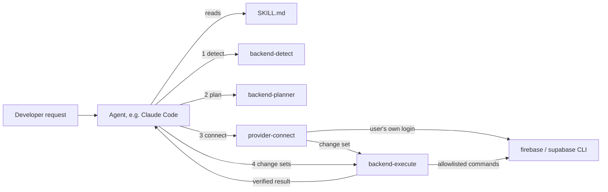
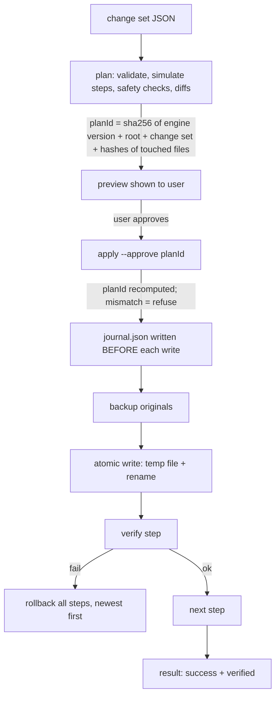

# Architecture

BackendPilot is a set of [Agent Skills](https://agentskills.io/specification). Each skill is a folder with a `SKILL.md` (instructions the agent reads) and scripts that do the work deterministically. The agent plans and explains; scripts detect, change and verify.

Status markers: **[built]** exists and is tested. **[planned]** is design only.

## Layers

| Layer | Skill | Writes files? |
|---|---|---|
| Intelligence | `backend-detect` [built], `backend-planner` [built] | No |
| Execution | `backend-execute` [built], `provider-connect` [built] | Only `backend-execute` |
| Validation | Safety checks + per-step verification in `backend-execute`, plan checks in `backend-planner` [built] | No |

Rule: only `backend-execute` writes to a project. Every other skill, present or future, produces a **change set** and hands it to the engine.

## Shared code [built]

Skills are installed by copying a folder, so a skill can't import `../../anything`. Shared code lives in `shared/` and `npm run sync:shared` copies it into `skills/<name>/scripts/shared/` with a "generated" header. `npm run validate:skills` (and a test) fails if a copy is stale. This settles open decision 1 (bundling, not an npm package): skills stay offline and dependency-free.

| Module | Contents |
|---|---|
| `shared/security.mjs` | Secret patterns, `redact()`, `findBlockedSecrets()`, client-exposed-prefix rules |
| `shared/exec.mjs` | `run()`: spawns CLIs with stdin closed, timeouts, and argument allowlisting |
| `shared/providers.mjs` | Declared provider capabilities and dashboard steps per sign-in method |

`backend-detect` predates `shared/` and keeps its own copy of the prefix regexes. Moving it onto `shared/` is a small follow-up.

## Execution engine [built]

`skills/backend-execute/scripts/engine.mjs`

- **State:** `.backendpilot/runs/<runId>/{journal.json, log.txt, backups/}`. The engine writes `.backendpilot/.gitignore` containing `*`, because backups can contain env values.
- **Interrupted runs:** the journal records every file's original hash and backup before writing. If the process dies, `rollback <runId>` restores from the journal (tested by killing a child process mid-run).
- **Conflicts:** rollback compares each file's current hash with what the engine wrote. Files edited by the user afterwards are left alone unless `--force`.
- **Verification:** writes are checked by hash; JSON merges by re-reading the keys; installs against `package.json` and `node_modules`; `supabase init`/`link` against the files they must create.
- **Commands:** only `supabase init` and `supabase link --project-ref <20-char ref>`. On Windows, npm-installed CLIs are `.cmd` shims that need `cmd.exe`; `run()` rejects any argument containing shell metacharacters before quoting, so caller input is never interpreted.

## Provider model [built: connection only]

Providers declare capabilities (`shared/providers.mjs`) instead of implementing one shared interface, because they differ. Firebase has Firestore and Security Rules; Supabase has Postgres and RLS. The `bp` field records what BackendPilot itself implements. Today that is `connect` and `selectProject` only.

Connection uses the official CLIs and the user's own login (`firebase login`, `supabase login`, run by the user). Web API keys and anon keys are public client identifiers and are never used for management.

## Planning [built: validation; generation planned]

The agent writes the plan; `check-plan.mjs` validates it against the provider's capabilities and the security rules, cross-checks it against the detect report, and marks each step `automated` (skill exists), `planned` (skill not built), or `manual`. It generates no rules, SQL or code yet.

## Safety model

All built and tested:

- Read-only scanning and planning; one writer (the engine).
- Paths: no absolute paths, `..`, NUL, Windows device names or streams, or symlink escapes; no writes into `.git`, `node_modules`, `.backendpilot`.
- Content: credentials blocked in source files; secret-named env vars can't have browser prefixes or agent-supplied values; `firebase-admin`/service-role refs blocked in `'use client'` files; Firebase rules with unconditional writes blocked; SQL disabling RLS, open write policies, and new public tables without RLS blocked. Problems already present are warnings, not blocks.
- Env files: values hidden in diffs, results and logs; existing keys never overwritten; must be gitignored in a git repo.
- Redaction applied to every error, log line and CLI output tail.

## Technical risks

| Risk | Mitigation |
|---|---|
| Regex-based SQL/rules checks miss unusual syntax | They are a guard, not a proof. Planned: rules tests in the emulator, `supabase db lint` |
| Agent approves on the user's behalf | The plan ID guarantees the applied change is the one previewed; SKILL.md requires asking. A machine check cannot prove a human approved |
| CLI output formats change | JSON output parsed; tolerant of banners and stderr noise; opt-in live tests |
| `install` rollback leaves `node_modules` | Documented; user reruns the package manager |

## Open design decisions

1. ~~Shared code distribution~~: settled, build-time copy (above).
2. ~~Approval mechanism~~: settled, two-step preview → apply with a content-bound plan ID.
3. TypeScript with a build step vs. JSDoc + `tsc --checkJs` (current).
4. Skill merges: proposal is `firebase-google-auth` → `firebase-auth`, `supabase-oauth` → `supabase-auth`, and the universal setup skills become routers. Decide when building auth skills.
5. Whether to automate project creation (`firebase projects:create`, `supabase projects create`). It needs billing/org choices and is hard to reverse, so it is left manual for now.
