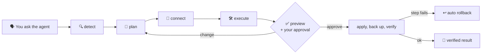

<div align="center">


# BackendPilot

### Your AI Agent. Your Backend. Fully Configured.

[Agent Skills](https://agentskills.io/) that let AI coding agents **detect, plan, connect and safely change**<br/>Firebase and Supabase backends in real apps, with a preview, an approval step and rollback for every change.

[](https://github.com/gyanranjan0300-glitch/backendpilot/actions/workflows/ci.yml)
[](LICENSE)


[Quick start](#-quick-start) · [Skills](#-skills) · [How it works](#-how-it-works) · [Safety](#-safety-first) · [Roadmap](ROADMAP.md) · [Architecture](ARCHITECTURE.md)

</div>

---

> [!NOTE]
> **Status: 0.2.0 (early).** Detection, planning, linking an existing Firebase or Supabase project, and a safe change engine work today. Automatic auth, database and storage setup is [on the roadmap](ROADMAP.md) and is **not** built yet.

## ✨ Why BackendPilot?

Wiring a backend into an existing app means SDKs, config files, env vars, auth providers, security rules or RLS, storage policies and dashboard settings, all of which must match the app you already have. AI agents asked to do this tend to guess.

BackendPilot gives your agent:

- 🔍 **Real facts** about your project, with the evidence behind each one
- 🧭 **A reviewable plan** that's checked for security before anything changes
- 🛡️ **A safe way to change files**: preview → your approval → apply → verify → rollback
- 🔐 **No secrets leaked**: env values never appear in output, logs or previews

## 🚀 Quick start

**Requires:** [Node.js 20+](https://nodejs.org/). The skills have no dependencies, so there's nothing to `npm install`.

```bash
git clone https://github.com/gyanranjan0300-glitch/backendpilot.git
```

**Add the skills to your agent:**

| Agent | Copy `skills/*` into |
|---|---|
| Claude Code | `~/.claude/skills/` (all projects) or `<project>/.claude/skills/` |
| Kiro | `~/.kiro/skills/` |
| Other [Agent Skills](https://agentskills.io/) agents | that agent's skills folder (untested) |

<details>
<summary>Windows (PowerShell)</summary>

```powershell
Copy-Item -Recurse -Force .\backendpilot\skills\* "$env:USERPROFILE\.claude\skills\"
```
</details>

<details>
<summary>macOS / Linux</summary>

```bash
mkdir -p ~/.claude/skills && cp -r backendpilot/skills/* ~/.claude/skills/
```
</details>

**Then just ask your agent:**

> 💬 *"What backend does this project use?"*<br/>
> 💬 *"Plan Supabase auth with Google sign-in and a private notes table."*<br/>
> 💬 *"Connect this project to my Supabase project."*

## 🧩 Skills

| | Skill | What it does | Writes files? |
|---|---|---|---|
| 🔍 | [`backend-detect`](skills/backend-detect/SKILL.md) | Scans the repo: frameworks, language, package manager, backend, auth, databases, storage, env var names, security findings | No |
| 🧭 | [`backend-planner`](skills/backend-planner/SKILL.md) | Validates the agent's backend plan: access rules, auth methods, storage limits, secrets, steps | No |
| 🔌 | [`provider-connect`](skills/provider-connect/SKILL.md) | Uses the Firebase / Supabase CLI and **your** login to list your projects and link one | No (makes a change set) |
| 🛠️ | [`backend-execute`](skills/backend-execute/SKILL.md) | The only writer: preview, approval, backups, atomic writes, verification, rollback | Yes, after approval |

<details>
<summary><b>What <code>backend-detect</code> recognises</b></summary>

- **Frameworks:** React, Next.js, Vue, Nuxt, Angular, Svelte, SvelteKit, Astro, Vite, Flutter
- **Runtimes:** Node.js, Express, NestJS, Fastify, Hono
- **Backends:** Firebase, Supabase (detection only for Appwrite, Convex, PocketBase)
- **Auth:** Firebase Auth, Supabase Auth, Auth.js, Clerk, Auth0, Passport, Better Auth, Lucia, plus the sign-in methods used in code
- **Databases:** Firestore, Realtime Database, Supabase Postgres, Prisma, Drizzle, Mongoose, MongoDB, pg, MySQL, TypeORM, Sequelize, Knex, Kysely, SQLite, Redis
- **Storage and functions:** Firebase Storage, Supabase Storage, S3, Cloudinary, UploadThing, Vercel Blob, Cloud Functions, Edge Functions
- **Routing and state:** Next.js routers, React Router, TanStack Router, Vue Router, go_router, Redux, Zustand, Jotai, Pinia, MobX, TanStack Query, Riverpod, flutter_bloc
- **Security findings:** committed or unignored `.env` files, service-account JSON files, secrets behind `NEXT_PUBLIC_` / `VITE_` prefixes

Tested on 27 real projects.
</details>

## ⚙️ How it works



Every change goes through **one engine**:

```text
preview  →  you approve (plan ID tied to the exact diff)  →  apply with backups
        →  verify each step  →  success   ·   failure → automatic rollback
```

<details>
<summary><b>Use the scripts directly</b></summary>

```bash
# 1. Scan a project
node skills/backend-detect/scripts/scan.mjs ../my-app --format markdown

# 2. See your cloud projects (log in first with `supabase login` / `firebase login`)
node skills/provider-connect/scripts/connect.mjs supabase projects

# 3. Make a change set, preview it, then apply with the ID the preview prints
node skills/provider-connect/scripts/connect.mjs supabase select <ref> --root ../my-app --out ../my-app/link.json
node skills/backend-execute/scripts/engine.mjs preview ../my-app/link.json --root ../my-app
node skills/backend-execute/scripts/engine.mjs apply   ../my-app/link.json --approve <planId> --root ../my-app

# 4. Undo
node skills/backend-execute/scripts/engine.mjs runs --root ../my-app
node skills/backend-execute/scripts/engine.mjs rollback <runId> --root ../my-app
```
</details>

## 🛡️ Safety first

The engine **refuses** to:

| ❌ Blocked | Why |
|---|---|
| Write outside the project, or through `..` or a symlink that leads outside it | Path traversal |
| Put private keys, service-role keys, tokens or DB passwords in source files | Leaked credentials |
| Put secrets behind `VITE_` / `NEXT_PUBLIC_` prefixes | The bundler ships them to every browser |
| Use `firebase-admin` or a service-role key in `'use client'` files | Admin access in client code |
| Write Firebase rules like `allow write: if true` | Anyone could write |
| Disable RLS, add open write policies, or create tables without RLS | Your data would be open to anyone |
| Write to env files that git doesn't ignore | They'd get committed |

You also get these guarantees:

- 🔒 Env values are hidden in previews, results and logs
- 🙋 Nothing changes until you approve the exact preview
- 💾 Every file is backed up first, and edits you make later are never overwritten by a rollback
- 🔑 Credentials come only from **your own** CLI login; API keys are never used for admin access

More in [SECURITY.md](SECURITY.md).

## 📊 Status

| Area | Status |
|---|---|
| Project detection | ✅ Done |
| Plan validation | ✅ Done (does not generate rules, SQL or code yet) |
| Safe execution engine | ✅ Done |
| List and link Firebase / Supabase projects | 🟡 Supabase tested live; Firebase tested with a fake CLI |
| Firebase auth, Firestore, storage setup | 🔜 0.3.0 |
| Supabase auth, schema, RLS, storage | 🔜 0.4.0 |
| Security audit, Backend Doctor | 🔜 0.5.0 |
| Creating cloud projects | ⏸️ Manual for now |

**Known limits:** detection is static (it can't see dashboard settings); rolling back an install doesn't clean `node_modules`; only `package.json` and `pubspec.yaml` projects are covered.

## 🧪 Development

```bash
npm install
npm run check        # lint + type check + skill validation + 42 tests
```

See [DEVELOPMENT.md](DEVELOPMENT.md) for live CLI tests and how to add a skill.

## 🤝 Contributing

PRs welcome. Read [CONTRIBUTING.md](CONTRIBUTING.md) first. Report security issues privately ([SECURITY.md](SECURITY.md)).

<div align="center">

---

Made with 💜 for developers who'd rather build products than configure backends.

[MIT License](LICENSE)

</div>
