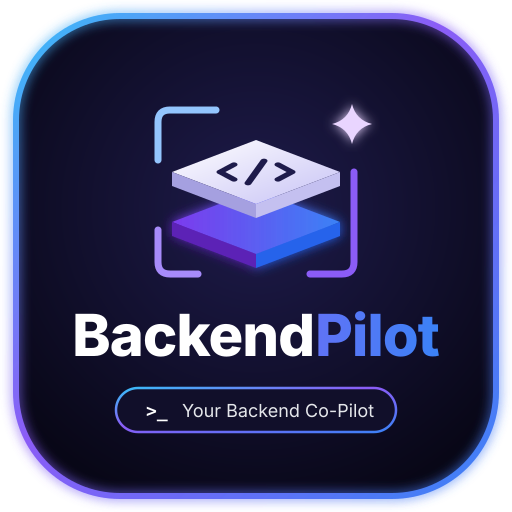
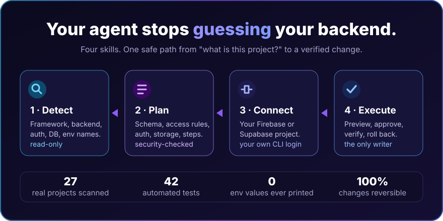
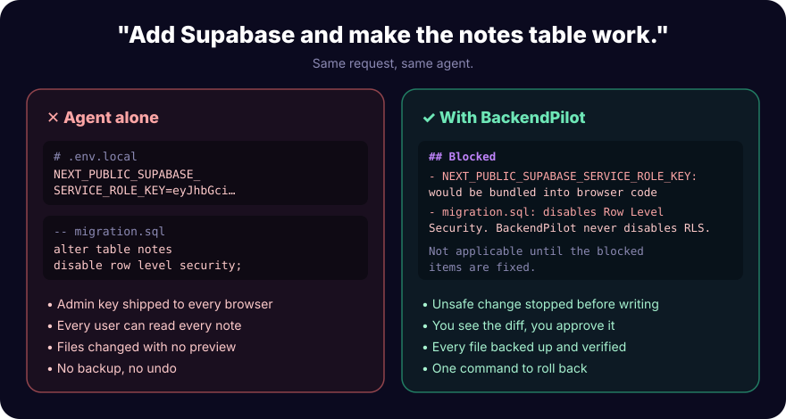
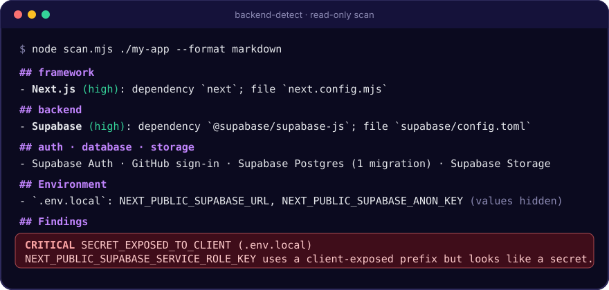
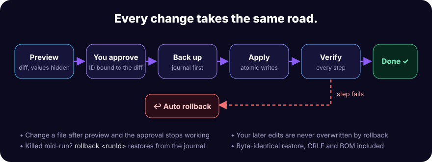

<p align="center">
  
</p>

<h1 align="center">BackendPilot</h1>

<p align="center">
  <em>Your AI agent. Your backend. Nothing changes until you say yes.</em>
</p>

<p align="center">
  <a href="https://github.com/gyanranjan0300-glitch/backendpilot/actions/workflows/ci.yml"></a>
  
  
  
  
  
</p>

<p align="center">
  
</p>

<p align="center">
  <strong>Detect · Plan · Connect · Execute</strong><br>
  <strong>Firebase and Supabase, set up by your agent, checked by code.</strong><br>
  <sub>Version 0.2.0. Detection, planning, project linking and the safe change engine work today. Auth, database and storage setup are <a href="ROADMAP.md">next</a>.</sub>
</p>

---

You ask your agent to "add Supabase auth". It guesses. It puts the admin key in a `NEXT_PUBLIC_` variable, turns off Row Level Security so the query works, and edits six files with no way back.

BackendPilot gives it facts instead of guesses, and a single road for every change: **preview, your approval, backup, verify, rollback.**

## Before / after

<p align="center">
  
</p>

These aren't hypothetical. They're the exact checks in [`checks.mjs`](skills/backend-execute/scripts/checks.mjs), and each one has a test.

## It reads your project first

<p align="center">
  
</p>

Every claim comes with its evidence: the dependency, the config file, or the import that proves it. A backend configured only in code is still found, and env **values** are never printed. Tested on 27 real projects.

## Every change takes the same road

<p align="center">
  
</p>

The approval ID covers the exact diff **and** the current contents of every file it touches. Edit a file after the preview and the old approval stops working. Kill the process halfway and `rollback <runId>` restores from the journal. Edits you make afterwards are never overwritten by a rollback unless you add `--force`.

## The skills

| | Skill | What it does | Writes? |
|---|---|---|---|
| 🔍 | [`backend-detect`](skills/backend-detect/SKILL.md) | Frameworks, language, package manager, backend, auth, databases, storage, env names, security findings | No |
| 🧭 | [`backend-planner`](skills/backend-planner/SKILL.md) | Checks the agent's plan: every table and bucket needs read/write rules, no public writes, no secrets in the browser | No |
| 🔌 | [`provider-connect`](skills/provider-connect/SKILL.md) | Lists your Firebase / Supabase projects with **your** CLI login and links one | No |
| 🛠️ | [`backend-execute`](skills/backend-execute/SKILL.md) | The only writer: preview, approval, backups, verification, rollback | After you approve |

## Never on the chopping block

The engine refuses, every time:

- Writing outside the project, through `..`, or through a symlink that leads outside it
- Private keys, service-role keys, tokens or DB passwords in source files
- Secrets behind `VITE_` / `NEXT_PUBLIC_` prefixes
- `firebase-admin` or a service-role key in `'use client'` files
- Firebase rules like `allow write: if true`
- Disabling RLS, open write policies, or new tables without RLS
- Env files that git doesn't ignore

Credentials come only from **your own** `firebase login` / `supabase login`. A web API key is a public identifier, so it's never used for admin access. More in [SECURITY.md](SECURITY.md).

## Install

Needs [Node.js 20+](https://nodejs.org/). The skills have no dependencies, so there's nothing to `npm install`.

```bash
git clone https://github.com/gyanranjan0300-glitch/backendpilot.git
```

**Claude Code** (macOS / Linux):

```bash
mkdir -p ~/.claude/skills && cp -r backendpilot/skills/* ~/.claude/skills/
```

**Claude Code** (Windows PowerShell):

```powershell
Copy-Item -Recurse -Force .\backendpilot\skills\* "$env:USERPROFILE\.claude\skills\"
```

**Kiro:** copy `skills/*` into `~/.kiro/skills/`. **Other [Agent Skills](https://agentskills.io/) agents:** use that agent's skills folder (untested).

Then ask:

```
What backend does this project use?
Plan Supabase auth with Google sign-in and a private notes table.
Connect this project to my Supabase project.
```

<details>
<summary><b>Run the scripts yourself</b></summary>

```bash
node skills/backend-detect/scripts/scan.mjs ../my-app --format markdown
node skills/provider-connect/scripts/connect.mjs supabase projects
node skills/provider-connect/scripts/connect.mjs supabase select <ref> --root ../my-app --out ../my-app/link.json
node skills/backend-execute/scripts/engine.mjs preview ../my-app/link.json --root ../my-app
node skills/backend-execute/scripts/engine.mjs apply   ../my-app/link.json --approve <planId> --root ../my-app
node skills/backend-execute/scripts/engine.mjs rollback <runId> --root ../my-app
```
</details>

## Status

| Area | |
|---|---|
| Project detection | ✅ Done |
| Plan validation | ✅ Done. It doesn't generate rules, SQL or code yet |
| Safe execution engine | ✅ Done |
| Link Firebase / Supabase projects | 🟡 Supabase tested live; Firebase tested with a fake CLI only |
| Firebase auth, Firestore, storage setup | 🔜 0.3.0 |
| Supabase auth, schema, RLS, storage | 🔜 0.4.0 |
| Security audit, Backend Doctor | 🔜 0.5.0 |

**Known limits:** detection is static, so dashboard settings are invisible. Rolling back an install leaves `node_modules` alone. Only `package.json` and `pubspec.yaml` projects are covered. CI runs on Linux and Windows; macOS hasn't been tested.

## FAQ

**Does it send my code anywhere?**
No. Everything runs on your machine. The only network calls are the official Firebase and Supabase CLIs, logged in as you.

**Can the agent skip the approval?**
The engine refuses to apply anything without the ID the preview printed, and that ID only fits that exact diff. It can't prove a human typed it, so the skill tells the agent to ask you.

**What if I really need RLS off?**
Then you turn it off yourself, on purpose. BackendPilot won't do it for you to make a query "work".

## Development

```bash
npm install
npm run check   # lint + type check + skill validation + 42 tests
```

See [DEVELOPMENT.md](DEVELOPMENT.md), [ARCHITECTURE.md](ARCHITECTURE.md) and [CONTRIBUTING.md](CONTRIBUTING.md).

## License

[MIT](LICENSE).

## Star History

<a href="https://www.star-history.com/#gyanranjan0300-glitch/backendpilot&Date">
  <picture>
    <source media="(prefers-color-scheme: dark)" srcset="https://api.star-history.com/svg?repos=gyanranjan0300-glitch/backendpilot&type=Date&theme=dark" />
    
  </picture>
</a>
